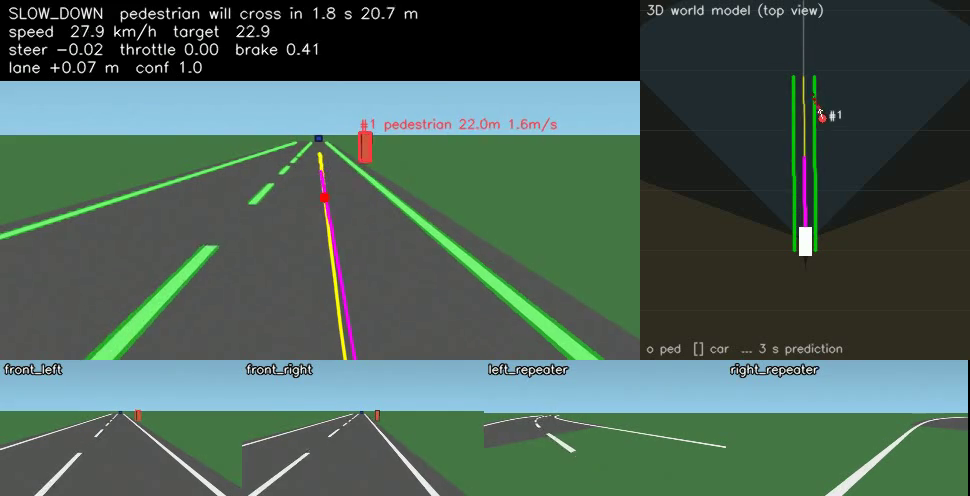
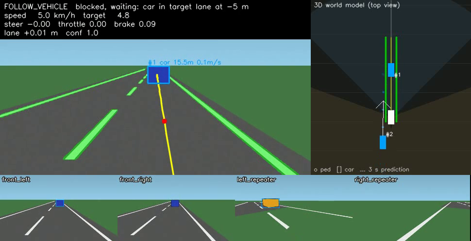
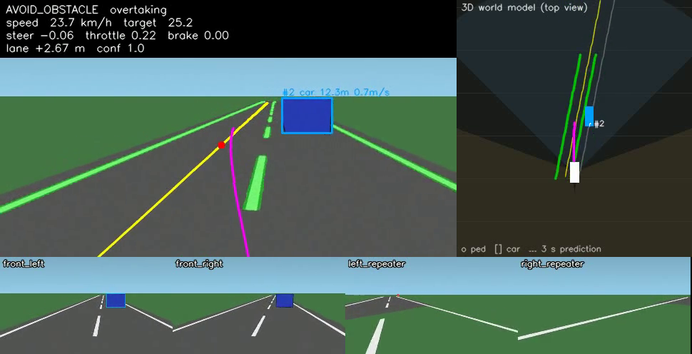
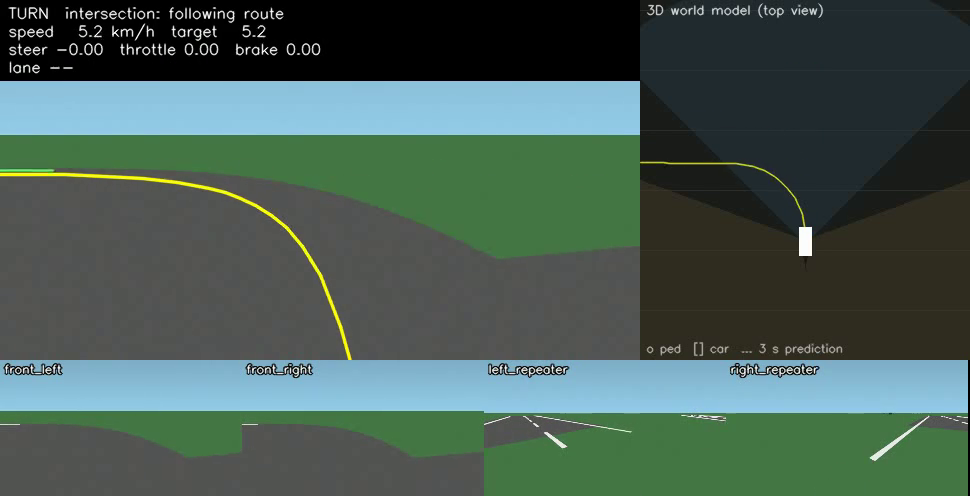

# Mini Tesla: autonomous driving with four cameras

A modular self-driving stack built with PyTorch and OpenCV. Four cameras build a tracked 3D model of
the world around the car. Every object's motion is predicted 3 seconds ahead, and a model-predictive
controller steers. It runs in **CARLA** or in a **built-in offline simulator**, so the whole pipeline
can be developed and tested on a laptop without CARLA installed.

```
 front-left  ─┐  stereo  ┌─ Lane CNN (PyTorch U-Net) ───────────────┐
 front-right ─┘  pair  ──┤                                          │
 left mirror  ───────────┼─ YOLO / object detector ─► 3D positions ─┼─► Kalman tracker ─► 3 s motion ─► Decision ─► Path ─► MPC steering ─┐
 right mirror ───────────┘   (all 4 cameras)     (stereo or ground-  │   (velocities,      prediction    engine     planner  Speed PID ────┴─► Vehicle
                                                  plane, with        │    ego-motion
                                                  covariance)        │    compensated)
```



*Top left: front camera with the CNN lane mask (green), planned path (yellow) and MPC-predicted
trajectory (magenta). Top right: the 3D world model from above, showing camera coverage, tracked
objects with velocity arrows and 3 s predictions. Bottom: all four camera feeds.*

## The camera rig

| Camera | Mount | Field of view | Job |
|---|---|---|---|
| `front_left` / `front_right` | windscreen, 0.54 m apart | 90° forward | lane detection, **stereo depth** for everything ahead |
| `left_repeater` / `right_repeater` | side mirrors, facing back (±130°) | 120° | blind spots, cars beside and up to 40 m behind |

Together the four cameras cover the front, both sides and the lanes behind. Everything is set in
`config/settings.yaml` (`cameras.rig`), so you can move, re-aim or add cameras without code changes.

## What it can do

- Follows its lane, steering from the CNN's lane-marking segmentation with **MPC**.
- Builds a **3D world model** from all four cameras. Objects ahead get stereo depth; objects to the side and behind
  get ground-plane estimates. When several cameras see the same object, their measurements are fused statistically.
- **Tracks** every car and pedestrian with a Kalman filter. The filter corrects for the car's own movement,
  so it estimates each object's real speed and direction over the ground.
- **Predicts** each object's path 3 s ahead:
  - slows down early for a pedestrian who is still on the pavement but walking towards the road;
  - reacts to cars predicted to **cut in**;
  - only changes lanes when the target lane is free **now and for the next 4 s**, including fast cars coming
    from behind that only the mirror cameras can see.
- Adaptive cruise control behind slower cars; stops for pedestrians and waits until they have crossed.
- Overtakes stopped vehicles, turns at intersections by following the route, stops at stop signs (YOLO/CARLA).

## Results (offline simulator, `python main.py --all-scenarios`)

| Scenario | Collisions | Route done | Mean lane error | What happens |
|---|---|---|---|---|
| `lane_keep` | 0 | 98% | 2.2 cm | gentle curves both ways |
| `curve` | 0 | 97% | 5.2 cm | 45–50 m radius bends |
| `pedestrian` | 0 | 96% | 0.8 cm | predicts the crossing **2.8 s ahead** and starts slowing 23.5 m out, stops, waits, continues |
| `obstacle` | 0 | 97% | 1.3 cm | overtakes a parked car through the left lane |
| `follow` | 0 | 96% | 0.0 cm | follows a 4 m/s car at a safe time gap for ~70 s |
| `turn` | 0 | 95% | 4.5 cm | 90° left turn through an intersection |
| `blind_spot` | 0 | 97% | 1.3 cm | parked car ahead, fast car approaching from behind in the left lane: **waits** until it has passed, then overtakes |
| `full` | 0 | 98% | 4.0 cm | everything on one 419 m route |

| Waiting for a car in the blind spot | Overtaking | Intersection turn |
|---|---|---|
|  |  |  |

"Route done" stops just short of 100% because the car parks 12 m before the end of the route.
Lane error is measured against the true lane centre while in lane-following mode, with the CNN and MPC driving.

**MPC vs PID steering** (mean lane error, same scenarios):

| Scenario | MPC | PID (pure pursuit) |
|---|---|---|
| `lane_keep` | **2.2 cm** | 4.5 cm |
| `curve` | **5.2 cm** | 10.7 cm |
| `turn` (lane following after the turn) | 4.5 cm | **1.6 cm** |

The lane CNN reaches **IoU 0.90** on held-out synthetic images (trained in ~6 min on an RTX 3050).

## Project layout

```
config/settings.yaml          all tunable parameters (camera rig, MPC/PID gains, speeds, distances)
simulation/
  carla_connection.py         CARLA client, synchronous mode, traffic, coordinate conversion
  camera_setup.py             the 4-camera rig in CARLA
  vehicle.py                  ego vehicle + collision / lane-invasion sensors
  carla_sim.py                CARLA backend (route via GlobalRoutePlanner, frames, metrics)
  offline_sim.py              built-in simulator: roads, traffic, pedestrians, rendering for every camera
perception/
  lane_detection.py           CNN or classical segmentation -> inverse perspective mapping -> lane fit
  object_detection.py         YOLO (one batch over all cameras) or ground-truth boxes
  stereo_depth.py             box matching, disparity -> depth, SGBM dense stereo, ground-plane fallback
models/
  lane_cnn.py                 U-Net lane-marking segmentation network
  train_lane_cnn.py           training (synthetic data or CARLA-collected data)
  weights/lane_cnn.pt         trained weights
fusion/
  camera_fusion.py            lane estimate + 3D measurements (with covariance) from all cameras
  tracker.py                  multi-object Kalman tracker, ego-motion compensation, trajectory forecast
planning/
  prediction.py               predicted corridor intrusions, lane-change safety check
  decision_engine.py          rule-based behaviour on the tracked world model
  path_planner.py             reference path (lane or route), lane-change offset, look-ahead point
control/
  mpc.py                      sampling-based model predictive steering (bicycle model + actuator lag)
  steering_pid.py             alternative: PID on the pure-pursuit steering angle
  speed_controller.py         PID speed -> throttle / brake
  pid.py                      PID with anti-windup
evaluation/metrics.py         collisions, lane error, completion, detection rate, ...
autopilot.py                  wires the layers together for one tick, plus the front / top-down / camera views
main.py                       command line entry point
scripts/collect_carla_data.py lane dataset from CARLA's semantic segmentation camera
tests/                        unit tests + closed-loop driving tests
```

## Setup

```bash
python -m venv .venv && .venv\Scripts\activate        # Windows (source .venv/bin/activate on Linux)
pip install torch --index-url https://download.pytorch.org/whl/cu128   # GPU build; plain `pip install torch` for CPU
pip install -r requirements.txt
```

## Running

```bash
python main.py --scenario full --display          # live view (press q to quit)
python main.py --scenario blind_spot --video out/blind.mp4
python main.py --all-scenarios --metrics out/report.json
python main.py --controller pid                   # compare with PID steering
python main.py --lane-method classical            # compare against non-learned lane detection
```

Scenarios: `lane_keep`, `curve`, `pedestrian`, `obstacle`, `follow`, `turn`, `blind_spot`, `full` (one long route
with a pedestrian, a parked car and an intersection).

### With CARLA (0.9.16 recommended)

1. Download CARLA 0.9.16 and start the server: `CarlaUE4.exe -quality-level=Low` (Low quality suits a 4 GB GPU).
2. `pip install carla==0.9.16 ultralytics`
3. For proper turn-by-turn routing, put CARLA's agents package on the path:
   `set PYTHONPATH=%PYTHONPATH%;<CARLA_ROOT>\PythonAPI\carla`
4. `python main.py --backend carla --display`

Edit the `carla:` block in `config/settings.yaml` to change the town, the start and destination spawn points, and the amount of traffic.
YOLO runs automatically on all four cameras in CARLA. `--detector ground_truth` uses CARLA's actor positions instead, which
helps when debugging planning separately from perception. With 4 cameras, YOLOv8n plus the lane CNN fit in 4 GB of VRAM;
lower `cameras.width/height` if the frame rate drops.

### Training the lane CNN

```bash
python -m models.train_lane_cnn --samples 4000 --epochs 12          # synthetic data
python scripts/collect_carla_data.py --frames 3000                  # CARLA data (server running)
python -m models.train_lane_cnn --data data/carla_lanes --epochs 20
```

For CARLA, train on CARLA data. The shipped weights only cover the offline simulator's look.
Until you retrain, `lane_method: classical` is the safer choice in CARLA.

## Tests

```bash
python -m pytest -m "not slow"     # 62 unit tests, under a minute
python -m pytest -m slow           # closed-loop drives: lanes, pedestrian, obstacle, follow, turn, blind spot
```

## How it works

- **Lane detection**: the CNN gives a per-pixel probability of lane paint. Every paint pixel is projected onto the
  road plane using the known camera height and pitch (inverse perspective mapping). A histogram finds the nearest
  marking on each side, and a sliding window traces each one before a quadratic `y = c0 + c1·x + c2·x²` is fitted.
  Both front cameras' estimates are fused by confidence and smoothed over time.
- **3D measurements**: the front cameras are parallel and 0.54 m apart, so an object appears shifted by `d = f·B / Z`
  pixels between them, which gives its depth `Z`. Objects seen by one camera only (the mirror cameras, or the edge of
  the stereo view) are placed where the bottom of their box touches the road. Each measurement carries a covariance:
  stereo error grows with `Z²`, ground-plane error grows linearly. Boxes cut off by the image border are not
  trusted for stereo.
- **Tracking**: one constant-velocity Kalman filter per object, with state `[x, y, vx, vy]` in the car's frame. Each tick the
  tracks are shifted and rotated by the car's own motion (speed and yaw rate), predicted forward, and matched to the new
  measurements with a Mahalanobis gate. The velocity is then the object's true ground speed.
- **Prediction**: each track is extended 3 s ahead at constant velocity. The planner checks whether a predicted path enters
  its driving corridor (crossing pedestrian, car cutting in). Before a lane change, it checks whether any predicted car
  will be alongside or just behind the car in the target lane within 4 s. A car behind whose speed isn't known yet
  counts as unsafe.
- **Decisions**: a priority list where the most restrictive target speed wins. In order: pedestrian in or entering the
  path, stop sign, stopped car (overtake only if safe, else wait), moving car or cut-in (adaptive cruise control),
  intersection, lost lane, then cruise.
- **MPC steering**: every tick about 100 steering plans are simulated 2 s into the future with a kinematic bicycle model
  that includes steering lag. Each plan is one steering angle, then a second after 0.6 s. Plans are scored on path
  distance, heading error, steering effort and smoothness, and the first step of the best plan is applied. A PID
  maps speed error to throttle or brake.

## Limitations

- There is no camera looking straight back over the boot. The mirror cameras cover the lanes behind, but a car directly
  behind in your own lane is only seen at an angle.
- The mirror cameras give single-camera distances, so positions to the side and behind are less accurate than stereo ahead
  (±1–3 m at 30 m). The tracker and the conservative lane-change rule allow for this.
- Prediction assumes constant velocity. It handles crossing, cut-ins and fast approaches, but not braking or turning
  agents. A learned predictor would be the next step.
- The offline simulator draws cars and pedestrians as boxes and takes their image boxes from ground truth, since YOLO
  is not trained on cartoon renders. Lane detection there is real: CNN on the rendered images.
- The CARLA backend follows the CARLA 0.9.14–0.9.16 Python API but was written without a CARLA server available,
  so expect to tune gains and thresholds on first contact.
- No traffic-light handling yet; the YOLO classes are already mapped.
