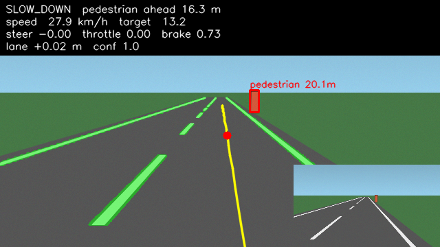
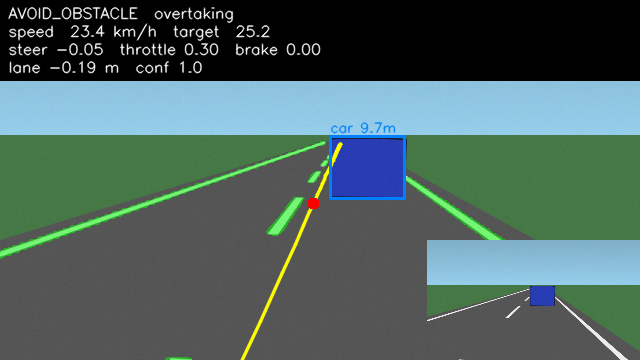
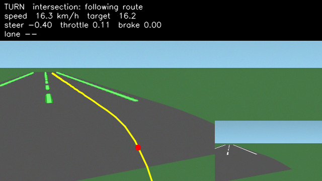

# Mini Tesla: autonomous driving with two cameras

A modular self-driving stack built with PyTorch and OpenCV. It runs in **CARLA** or in a
**built-in offline simulator**, so the whole pipeline can be developed and tested on a laptop
without CARLA installed.

```
 Camera L ─┐     ┌─ Lane CNN (PyTorch U-Net) ─┐
           ├────►│                            ├─► Fusion ─► Decision engine ─► Path planner ─► Steering PID ─┐
 Camera R ─┘     └─ YOLO / object detector ───┘   (stereo     (rules)          (lane / route)  Speed PID ────┴─► Vehicle
                                                   depth)
```

| Lane CNN + path + stereo distance | Overtaking a stopped car | Turning at an intersection |
|---|---|---|
|  |  |  |

## What it can do

- Follows its lane autonomously, steering from the CNN's lane-marking segmentation.
- Steers, accelerates and brakes on its own using PID control.
- Detects vehicles and measures their distance with stereo vision (disparity between the two cameras).
- Adaptive cruise control: follows a slower car at a set time gap (a Kalman filter estimates the lead car's speed).
- Detects pedestrians, stops for them, and waits until the road is clear.
- Avoids obstacles: overtakes a stopped vehicle through the free left lane, then returns to its lane.
- Turns at intersections by following the navigation route where there are no lane markings.
- Stops at stop signs (YOLO / CARLA only).

## Results (offline simulator, `python main.py --all-scenarios`)

| Scenario | Collisions | Route done | Mean lane error | Notes |
|---|---|---|---|---|
| `lane_keep` | 0 | 98% | 4.5 cm | gentle curves both ways |
| `curve` | 0 | 97% | 10.7 cm | 45–50 m radius bends |
| `pedestrian` | 0 | 96% | 1.0 cm | slowed, stopped, waited for the crossing, continued |
| `obstacle` | 0 | 97% | 2.4 cm | overtook a parked car through the left lane |
| `follow` | 0 | 96% | 0.4 cm | followed a 4 m/s car for ~70 s at a safe gap |
| `turn` | 0 | 95% | 1.6 cm | 90° left turn through an intersection |
| `full` | 0 | 98% | 4.9 cm | all of the above on one 419 m route |

"Route done" stops just short of 100% because the car parks 12 m before the end of the route.
Lane error is measured against the true lane centre while in lane-following mode, with the CNN driving.

The lane CNN reaches **IoU 0.90** on held-out synthetic images (trained in ~6 min on an RTX 3050).

## Project layout

```
config/settings.yaml          all tunable parameters (cameras, PID gains, speeds, distances)
simulation/
  carla_connection.py         CARLA client, synchronous mode, traffic, coordinate conversion
  camera_setup.py             two RGB cameras as a parallel stereo rig
  vehicle.py                  ego vehicle + collision / lane-invasion sensors
  carla_sim.py                CARLA backend (route via GlobalRoutePlanner, frames, metrics)
  offline_sim.py              built-in simulator: roads, traffic, pedestrians, perspective rendering
perception/
  lane_detection.py           CNN or classical segmentation -> inverse perspective mapping -> lane fit
  object_detection.py         YOLO (ultralytics) or ground-truth boxes
  stereo_depth.py             box matching, disparity -> depth, SGBM dense stereo, mono fallback
models/
  lane_cnn.py                 U-Net lane-marking segmentation network
  train_lane_cnn.py           training (synthetic data or CARLA-collected data)
  weights/lane_cnn.pt         trained weights
fusion/camera_fusion.py       one lane estimate + 3D object list from both cameras
planning/
  decision_engine.py          rule-based behaviour (stop / follow / overtake / turn / slow down)
  path_planner.py             reference path (lane or route), lane-change offset, look-ahead point
control/
  pid.py                      PID with anti-windup
  steering_pid.py             PID on the pure-pursuit steering angle
  speed_controller.py         PID speed -> throttle / brake
evaluation/metrics.py         collisions, lane error, completion, detection rate, ...
autopilot.py                  wires the layers together for one tick, plus the debug overlay
main.py                       command line entry point
scripts/collect_carla_data.py lane dataset from CARLA's semantic segmentation camera
tests/                        unit tests + closed-loop driving tests
```

## Setup

```bash
python -m venv .venv && .venv\Scripts\activate        # Windows (source .venv/bin/activate on Linux)
pip install torch --index-url https://download.pytorch.org/whl/cu128   # GPU build; plain `pip install torch` for CPU
pip install -r requirements.txt
```

## Running

```bash
python main.py --scenario full --display          # live view (press q to quit)
python main.py --scenario pedestrian --video out/ped.mp4
python main.py --all-scenarios --metrics out/report.json
python main.py --lane-method classical            # compare against non-learned lane detection
```

Scenarios: `lane_keep`, `curve`, `pedestrian`, `obstacle`, `follow`, `turn`, `full` (all of them on one route).

### With CARLA (0.9.16 recommended)

1. Download CARLA 0.9.16 and start the server: `CarlaUE4.exe -quality-level=Low` (Low quality suits a 4 GB GPU).
2. `pip install carla==0.9.16 ultralytics`
3. For proper turn-by-turn routing, put CARLA's agents package on the path:
   `set PYTHONPATH=%PYTHONPATH%;<CARLA_ROOT>\PythonAPI\carla`
4. `python main.py --backend carla --display`

Edit the `carla:` block in `config/settings.yaml` to change the town, the start and destination spawn points, and the amount of traffic.
YOLO is used automatically in CARLA. `--detector ground_truth` uses CARLA's actor positions instead, which helps when debugging planning separately from perception.

### Training the lane CNN

```bash
python -m models.train_lane_cnn --samples 4000 --epochs 12          # synthetic data
python scripts/collect_carla_data.py --frames 3000                  # CARLA data (server running)
python -m models.train_lane_cnn --data data/carla_lanes --epochs 20
```

For CARLA, train on CARLA data. The shipped weights only cover the offline simulator's look.
Until you retrain, `lane_method: classical` is the safer choice in CARLA.

## Tests

```bash
python -m pytest -m "not slow"     # ~50 unit tests, about 1 minute
python -m pytest -m slow           # closed-loop drives: lane keeping, pedestrian, obstacle, follow, turn
```

## How it works

- **Lane detection**: the CNN gives a per-pixel probability of lane paint. Every paint pixel is projected
  onto the road plane using the known camera height and pitch (inverse perspective mapping). A histogram finds the nearest
  marking on each side of the car, and a sliding window traces each one before a quadratic
  `y = c0 + c1·x + c2·x²` is fitted. Both cameras' estimates are fused by confidence and smoothed over time.
- **Stereo depth**: the cameras are parallel and 0.54 m apart, so the same object appears shifted by
  `d = f·B / Z` pixels. Detections are matched across the images, `Z` follows from the shift, and the box centre
  is back-projected into 3D. Objects seen by only one camera use a ground-plane estimate instead.
- **Decisions**: a priority list where the most restrictive target speed wins. In order: pedestrian in path, stop sign,
  stopped car (overtake if the left lane is free, otherwise stop), moving car (adaptive cruise control), intersection,
  lost lane, then cruise. An object is "in path" when it lies inside a corridor around the planned path.
- **Control**: a look-ahead point on the path gives the pure-pursuit steering angle, which a PID tracks.
  The look-ahead grows with speed. A second PID maps speed error to throttle or brake.

## Limitations

- The two forward cameras see only about 90° ahead. There is no rear or side vision, so lane changes rely on the left lane
  having been clear while it was in view.
- The offline simulator draws cars and pedestrians as boxes and takes their image boxes from ground truth, since YOLO
  is not trained on cartoon renders. Lane detection there is real: CNN on the rendered images.
- The CARLA backend follows the CARLA 0.9.14–0.9.16 Python API but was written without a CARLA server available,
  so expect to tune gains and thresholds on first contact.
- No traffic-light handling yet; the YOLO classes are already mapped, so this is a natural next step.
